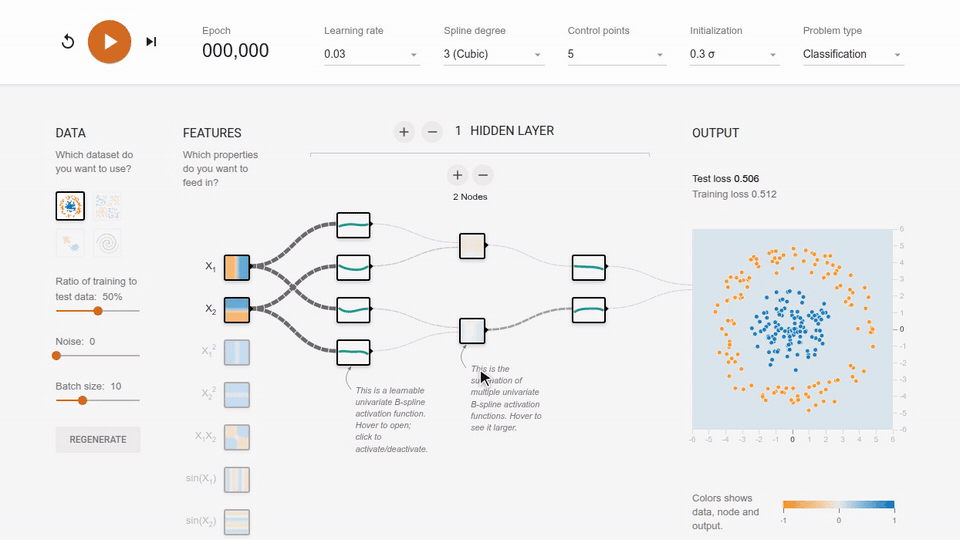

# KANLab

**Try it live at [kanlab.app](https://kanlab.app)**

An interactive visualization of Kolmogorov-Arnold Networks (KANs), based on Deep Playground,
written in TypeScript using d3.js. We use GitHub issues for tracking new requests and bugs.
Your feedback is highly appreciated!

[](https://kanlab.app)

**If you'd like to contribute, be sure to review the [contribution guidelines](CONTRIBUTING.md).**

## Citation

KANLab is described in the following paper. If you use KANLab in your research or teaching, please cite:

> Lukas Niehaus, Robin Rawiel, and Ulf Krumnack. *KANLab: TensorFlow Playground for Kolmogorov-Arnold Networks*. arXiv preprint arXiv:2610.20117, 2026. https://arxiv.org/abs/2610.20117

```bibtex
@misc{niehaus2026kanlab,
  title         = {{KANLab}: {TensorFlow} Playground for {Kolmogorov-Arnold} Networks},
  author        = {Niehaus, Lukas and Rawiel, Robin and Krumnack, Ulf},
  year          = {2026},
  eprint        = {2610.20117},
  archivePrefix = {arXiv},
  primaryClass  = {cs.LG},
  url           = {https://arxiv.org/abs/2610.20117}
}
```

## Development

To run the visualization locally, run:
- `npm i` to install dependencies
- `npm run build` to compile the app and place it in the `dist/` directory
  (set `GA_MEASUREMENT_ID` in `.env` to enable Google Analytics; it is off otherwise)
- `npm run serve` to serve from the `dist/` directory and open a page on your browser.

For a fast edit-refresh cycle when developing run `npm run serve-watch`.
This will start an http server and automatically re-compile the TypeScript,
HTML and CSS files whenever they change.

## Docker

The production setup serves the app with nginx in a container and exposes it through a
[Cloudflare Tunnel](https://developers.cloudflare.com/cloudflare-one/connections/connect-networks/),
so the server needs no open web ports:
- copy `.env.example` to `.env` and set `TUNNEL_TOKEN` (and optionally `GA_MEASUREMENT_ID`)
- in the tunnel's public hostnames, route `kanlab.app` to `http://kanlab:80`
- `docker compose up -d --build`

To run it locally without the tunnel:
- `docker build -t kanlab .` (add `--build-arg GA_MEASUREMENT_ID=G-...` for analytics)
- `docker run --rm -p 8080:80 kanlab` and open http://localhost:8080

This is not an official Google product.
